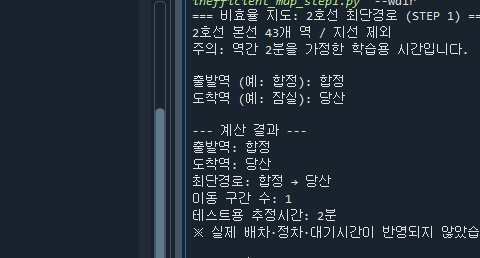
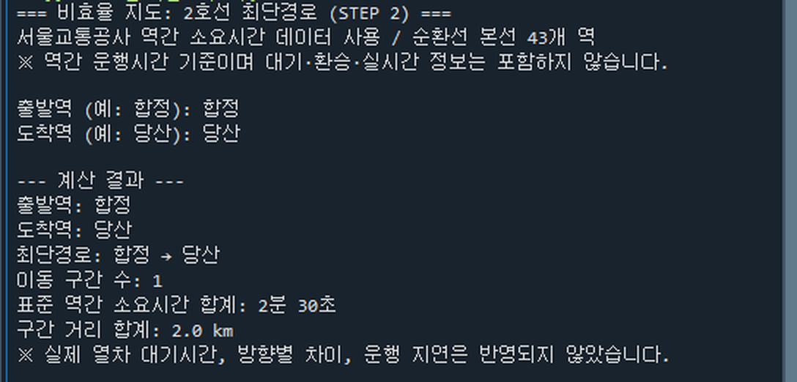

# 🚇 비효율 지도 (Inefficient Map)

> **조금 늦어도, 창밖이 좋은 길로.**

**비효율 지도**는 목적지까지 가장 빨리 도착하는 경로뿐 아니라, **이동하는 동안 좋은 풍경을 만날 수 있는 서울 지하철 경로**를 추천하는 것을 목표로 하는 오픈소스 프로젝트입니다.

**프로젝트 상태:** STEP 2 완료 — 공식 자료의 역간 표준 소요시간을 적용한 2호선 순환선 최단경로 계산  
**개발 언어:** Python  
**개발 환경:** Anaconda / Spyder  
**대상 교통수단:** 지하철 (도보 관광·버스 경로는 현재 범위에서 제외)

> **안내:** 현재 실행 가능한 최신 버전은 [`inefficient_map_step2.py`](inefficient_map_step2.py)입니다. 서울교통공사에서 공개한 역간 표준 소요시간을 활용하지만 **열차 대기·환승·운행 지연·방향별 차이를 반영하지 않으므로 실제 길 찾기나 실시간 도착 예측에 사용할 수 없습니다.** 풍경 우선 경로 추천은 아직 구현 전입니다. STEP 1의 구간당 2분 가정은 구버전 학습 코드에만 적용됩니다.

---

## 1. 프로젝트 소개 (Overview)

기존 길 찾기 서비스는 주로 최단시간, 최단거리, 최소 환승을 중심으로 경로를 안내합니다. 하지만 이동할 때 언제나 가장 빨리 도착하는 것이 최선은 아닐 수 있습니다.

**비효율 지도 (Inefficient Map)**는 사용자가 출발역과 도착역을 입력하면, **허용 가능한 추가 이동시간** 안에서 지상철과 한강 횡단 구간 등 **이동 중 풍경을 감상할 수 있는 대체 경로**를 탐색하는 것을 최종 목표로 합니다.

> **“10분쯤 더 걸리더라도 한강 풍경을 보면서 갈 수는 없을까?”**

이 프로젝트는 이동을 일부러 느리게 만드는 것이 아니라, **시간뿐 아니라 이동 경험까지 경로 선택의 기준으로 삼는 것**을 지향합니다.

## 2. 개발 동기 (Motivation)

서울에 올라온 뒤 지상철을 타며 도시 풍경을 바라보는 경험이 인상 깊었습니다. 특히 지하철이 한강 위를 지날 때 차창 밖으로 펼쳐지는 풍경은 일상적인 이동을 작은 여행처럼 느끼게 했습니다.

이 경험에서 출발해, 목적지가 정해진 상황에서도 **아름다운 풍경을 보기 위해 조금 돌아가는 선택지**를 제공하는 프로그램을 기획했습니다.

## 3. 주요 기능 및 구현 상태 (Key Features)

| 기능 | 설명 | 현재 상태 |
| --- | --- | --- |
| **2호선 순환선 최단경로 계산** | 다익스트라 알고리즘으로 구간별 시간의 합이 최소인 경로 계산 | ✅ STEP 1·2 구현 |
| 사용자 역 입력 | 역 이름 입력, 공백 제거, `역` 접미사 처리, 유효성 검사 | ✅ STEP 1·2 구현 |
| **표준 역간 운행시간 적용** | 서울교통공사 공개 자료로 구간별 실제 데이터 가중치 적용 | ✅ STEP 2 구현 |
| **경로 거리 합계** | 최단시간 경로의 역간 거리 합산 | ✅ STEP 2 구현 |
| **자동 테스트** | 43개 역·연결 검증, 경로·시간·입력 조건 확인 | ✅ STEP 2 구현 (5개) |
| 다중 노선 및 환승 | 다른 노선의 연결 및 환승 소요시간 반영 | ⬜ 예정 |
| 지상철 구간 분석 | 지상 운행 구간을 구분해 경관 평가 | ⬜ 예정 |
| 한강 횡단 구간 분석 | 한강을 건너는 구간에 풍경 가점 부여 | ⬜ 예정 |
| 풍경 우선 대체 경로 추천 | 허용시간 안에서 풍경 점수가 높은 경로 탐색 | ⬜ 예정 |
| 추가 이동시간 설정 | 사용자가 감수할 우회시간 선택 | ⬜ 예정 |
| 경로 비교 및 지도 시각화 | 최단경로와 풍경 경로의 시간·특징 비교 | ⬜ 예정 |

### 향후 확장 아이디어

- **노을·야경:** 일몰 시각과 실제 구간 통과 예상 시각을 고려한 추천
- **축제·행사:** 행사 일정·위치와 열차 운행 조건을 참고한 추천
- **계절별 풍경:** 벚꽃·단풍 등 계절 요소 반영
- **차창 방향:** 진행 방향에 따른 주요 풍경 안내
- **혼잡도:** 이동 쾌적성을 고려한 추천

이 기능들은 **아이디어 단계**이며, 핵심 경로 추천 기능이 구현된 후 개발 여부를 결정합니다.

## 4. 현재 구현 내용 — STEP 1 및 STEP 2 (Implementation)

### STEP 1 — 그래프와 다익스트라 알고리즘의 기본 구현

[`inefficient_map_step1.py`](inefficient_map_step1.py)에서는 2호선 순환선 **43개 역**을 정점(Node)으로, 인접 역 사이의 연결을 간선(Edge)으로 표현했습니다. Python 표준 라이브러리 `heapq`를 이용해 다익스트라(Dijkstra) 최단경로 탐색을 직접 구현했습니다.

처음에는 모든 역간 이동시간을 **2분**으로 가정하여 입력과 경로 탐색을 검증했습니다. 이 파일은 구현 과정을 보여주는 **학습용 이전 버전**이며, 현재 추천하는 실행 파일이 아닙니다.

### STEP 2 — 공개 자료의 역간 소요시간과 거리 적용

[`inefficient_map_step2.py`](inefficient_map_step2.py)는 STEP 1의 경로 탐색을 공식 데이터 기반으로 개선한 버전입니다.

- **정점(Node):** 서울 지하철 2호선 순환선의 역 43개
- **간선(Edge):** 인접 역을 잇는 연결 43개(양방향으로 저장)
- **시간 가중치(Weight):** 공개 CSV의 역간 표준 소요시간을 **초 단위**로 변환
- **거리:** 공개 CSV의 역간 거리(km)를 별도로 저장하고, 선택된 경로의 총거리를 합산
- **탐색:** 누적 소요시간이 가장 작은 경로를 다익스트라 알고리즘으로 계산
- **입력 검증:** 지원하지 않는 역, 출발역과 도착역이 같은 경우 등을 구분해 처리

#### 데이터 처리 과정

1. 제공받은 서울교통공사 원본 CSV에서 **2호선 데이터**를 추출했습니다.
2. **2호선 본선 순환선**만 구분해, 성수지선·신정지선은 현재 모델에서 제외했습니다.
3. 원본 `MM:SS` 역간 소요시간을 초로 바꾸고, 거리(km)를 함께 저장했습니다.
4. 가공한 데이터를 [`data/line2_main_240810.csv`](data/line2_main_240810.csv)에 저장했습니다.
5. 코드가 가공 CSV를 읽어 그래프를 생성하도록 했습니다.

가공 규칙과 원본 파일 정보는 [`data/SOURCE.md`](data/SOURCE.md)에 별도로 기록했습니다.

#### 최단경로 계산 과정

1. 출발역의 누적시간은 `0`, 나머지 역은 무한대로 설정합니다.
2. 우선순위 큐(`heapq`)에서 현재까지 시간이 가장 짧은 역을 꺼냅니다.
3. 인접 역의 구간 소요시간을 더해 더 빠른 경로를 찾으면 누적시간과 이전 역을 갱신합니다.
4. 도착역의 최단시간이 결정되면 이전 역을 역추적해 전체 경로를 복원합니다.
5. 최단시간 경로, 구간 수, **표준 역간 소요시간의 합계**, **거리 합계**를 출력합니다.

### 테스트 및 현재 한계

[`tests/test_step2.py`](tests/test_step2.py)는 Python의 `unittest`를 사용하며, 현재 **5개 테스트가 통과**했습니다. 확인 항목은 순환선 정점·연결 수, `합정 → 당산` 시간·거리, `충정로 → 시청` 연결, 동일 출발·도착역 처리, 시간 출력 형식입니다.

단, 현재 모델에는 다음 한계가 있습니다.

- **2호선 본선 순환선만** 지원하며 지선, 다른 노선, 환승은 포함하지 않습니다.
- 원본에 방향별 시간이 별도로 제공되지 않아 **양방향에 같은 구간 시간을 적용**합니다.
- 열차 대기시간, 배차 간격, 운행 지연, 시간대별 변경 사항을 반영하지 않습니다.
- 공개 자료의 표준 운행시간을 합산한 값이며 **실제 여행 전체 소요시간을 보장하지 않습니다.**
- **지상 운행·한강 횡단 풍경 점수와 풍경 우선 추천 기능은 아직 구현되지 않았습니다.**

## 5. 향후 추천 알고리즘 (Planned Scenic Routing)

향후에는 최단경로의 소요시간을 기준으로 **추가 이동시간 제한**을 적용하고, 그 안에서 풍경 점수가 높은 대체 경로를 찾는 방식을 개발할 예정입니다.

예를 들어 최단경로가 30분이고 사용자가 10분의 우회를 허용하면, 예상 이동시간 40분 이내의 후보 중 풍경 점수가 높은 경로를 추천하는 식입니다. 이 수치는 **개념 설명용 예시**입니다.

풍경 점수에는 지상 구간, 한강 횡단, 도시 전망 등을 반영하는 방안을 검토하고 있습니다. 점수 계산 규칙과 대체 경로 탐색 기법은 향후 실험을 통해 구체화합니다. 의미 있는 대체 경로가 없으면 무리한 우회를 추천하지 않도록 설계할 계획입니다.

## 6. 설치 및 실행 (Installation & Usage)

### 요구 사항

- **Python 3.x** (사용자 환경: Anaconda / Spyder, Python 3.14)
- 별도 외부 Python 패키지 설치 불필요 (`csv`, `heapq`, `pathlib`, `unittest`는 표준 라이브러리)
- STEP 2를 실행하려면 [`data/line2_main_240810.csv`](data/line2_main_240810.csv) 파일이 함께 있어야 합니다.

### 권장 실행 방법 — STEP 2

**Spyder에서 실행**

1. GitHub 저장소를 클론하거나 ZIP으로 내려받습니다.
2. `inefficient_map_step2.py`와 `data/line2_main_240810.csv`의 상대 경로를 그대로 유지합니다.
3. Spyder에서 [`inefficient_map_step2.py`](inefficient_map_step2.py)를 열고 `F5`를 누릅니다.
4. IPython Console에서 출발역과 도착역을 입력합니다. (`합정`, `합정역` 모두 입력 가능)

**터미널에서 실행**

저장소 최상위 폴더에서 다음 명령어를 실행합니다.

```bash
python inefficient_map_step2.py
```

### STEP 2 실행 예시 — 합정 → 당산

```text
=== 비효율 지도: 2호선 최단경로 (STEP 2) ===
서울교통공사 역간 소요시간 데이터 사용 / 순환선 본선 43개 역
※ 역간 운행시간 기준이며 대기·환승·실시간 정보는 포함하지 않습니다.

출발역 (예: 합정): 합정
도착역 (예: 당산): 당산

--- 계산 결과 ---
출발역: 합정
도착역: 당산
최단경로: 합정 → 당산
이동 구간 수: 1
표준 역간 소요시간 합계: 2분 30초
구간 거리 합계: 2.0 km
※ 실제 열차 대기시간, 방향별 차이, 운행 지연은 반영되지 않았습니다.
```

**STEP 1(이전 버전)**을 실행하려면 `python inefficient_map_step1.py`를 사용합니다. STEP 1은 모든 구간을 2분으로 가정한 학습용 코드입니다.

### 자동 테스트

저장소 최상위 폴더에서 다음 명령어를 실행합니다.

```bash
python -m unittest discover -s tests -v
```

현재 STEP 2에 대해 **5개 테스트가 모두 통과**하는 것을 확인했습니다. 새 기능을 추가할 때 테스트를 확장할 계획입니다.

## 7. 시연 (Demonstration)

### STEP 1 — Spyder 콘솔 실행 화면

아래 이미지는 STEP 1 코드를 Spyder에서 실행하고 `합정 → 당산` 경로를 계산한 화면입니다.



### STEP 2 — 공식 역간 소요시간 적용 화면

아래는 Spyder에서 STEP 2를 실행하고 `합정 → 당산` 경로를 계산한 실제 콘솔 화면입니다. 원본 캡처에서 콘솔 출력 부분만 잘랐습니다.



> STEP 1·2 이미지는 실제 Spyder 실행 화면에서 일부를 잘라낸 것입니다. 현재는 콘솔 프로그램이며, 향후 두 경로를 지도에서 비교하는 UI를 구현할 계획입니다.

## 8. 개발 범위 (Scope)

- **교통수단:** 지하철 전용
- **사용 조건:** 출발역과 도착역이 정해진 이동
- **초기 실험 범위:** 서울 지하철 2호선 순환선
- **향후 확장:** 다른 노선, 환승, 지상/한강 구간, 지도 기반 시각화
- **현재 제외:** 버스 경로, 목적지 없는 관광 코스, 중간 하차 후 도보 관광

## 9. 개발 환경 (Tech Stack)

### 현재 사용 기술

- **Python 3 / Anaconda / Spyder:** 코드 작성과 실행
- **Python `heapq`:** 다익스트라 알고리즘의 우선순위 큐
- **Python `csv`, `pathlib`:** 공식 데이터 가공본 로딩 및 파일 경로 처리
- **Python `unittest`:** STEP 2 자동 테스트
- **Git / GitHub / GitHub Desktop:** 소스코드 및 개발 이력 관리

### 향후 도입 검토

- **NetworkX:** 다중 노선 그래프 모델링 및 경로 탐색
- **pandas:** 역간 소요시간·경관 정보 정리
- **Streamlit:** 사용자 인터페이스
- **Folium:** 지도 시각화

현재 STEP 1·2는 **NetworkX를 사용하지 않고**, Python 표준 라이브러리로 알고리즘을 직접 구현했습니다.

## 10. 개발 계획 (Roadmap)

- [x] 프로젝트 주제 및 핵심 목적 선정
- [x] 범위 확정 (지하철 전용)
- [x] GitHub 저장소 생성 및 GitHub Desktop 연결
- [x] STEP 1: 2호선 순환선 그래프 구성 및 최단경로 탐색 구현
- [x] STEP 1: Spyder에서 기본 실행 확인
- [x] STEP 2: 서울교통공사 역간 소요시간·거리 데이터 확보 및 적용
- [x] STEP 2: `unittest` 자동 테스트 5개 통과
- [x] STEP 2: Spyder에서 실제 데이터 기반 경로 계산 확인
- [ ] STEP 3: 지상 운행·한강 횡단 구간 데이터 구축
- [ ] STEP 4: 풍경 점수 설계 및 추가시간 제약이 있는 추천 알고리즘 구현
- [ ] STEP 5: 경로 비교 UI와 지도 시각화
- [ ] 경로별 정확도·실효성 실험 및 검증
- [ ] README에 최종 실행 가이드·시연 자료 반영

## 11. 데이터 출처 및 코드 작성 과정 (Data, References & Attribution)

- **서울교통공사 공개 자료:** [서울교통공사 역간거리 및 소요시간](https://data.seoul.go.kr/dataList/OA-12034/S/1/datasetView.do) — 원본 파일 `서울교통공사 역간거리 및 소요시간_240810.csv`. 본 프로젝트에서는 2호선 순환선 본선 43개 연결을 추출해 사용했습니다.
- **데이터 변환 및 재배포 안내:** [`data/SOURCE.md`](data/SOURCE.md)에 추출 과정, 양방향 시간 가정, 자료 시점, 이용조건 확인 사항을 기록했습니다. 원본 자료의 이용·재배포 조건을 별도로 확인해야 합니다.
- **코드:** STEP 1의 역간 2분 가정은 [`inefficient_map_step1.py`](inefficient_map_step1.py)에만 남아 있습니다. STEP 2는 [`inefficient_map_step2.py`](inefficient_map_step2.py)에서 가공 CSV의 표준 시간을 사용합니다.
- **표준 라이브러리:** Python [`heapq`](https://docs.python.org/3/library/heapq.html), [`csv`](https://docs.python.org/3/library/csv.html), [`pathlib`](https://docs.python.org/3/library/pathlib.html), [`unittest`](https://docs.python.org/3/library/unittest.html) 문서
- **코드·문서 작성 보조:** STEP 1·2 Python 코드, 데이터 가공 및 README 초안 작성에 **OpenAI ChatGPT**의 도움을 받았습니다. 로컬 Spyder 실행과 자동 테스트로 동작을 확인했으며, 기능별 구현·검증 내용을 Git 기록과 README에 계속 남길 예정입니다.

외부 코드, 자료, 오픈소스 라이브러리 등을 추가로 사용하게 되면 **출처, 라이선스, 실제 활용 부분**을 이 항목에 명확히 적겠습니다.

## 12. 라이선스 (License)

이 프로젝트는 **MIT License**로 공개합니다. 자세한 내용은 저장소의 [`LICENSE`](LICENSE) 파일을 참고해 주세요.

---

**Inefficient Map — The journey matters, not just the destination.**
